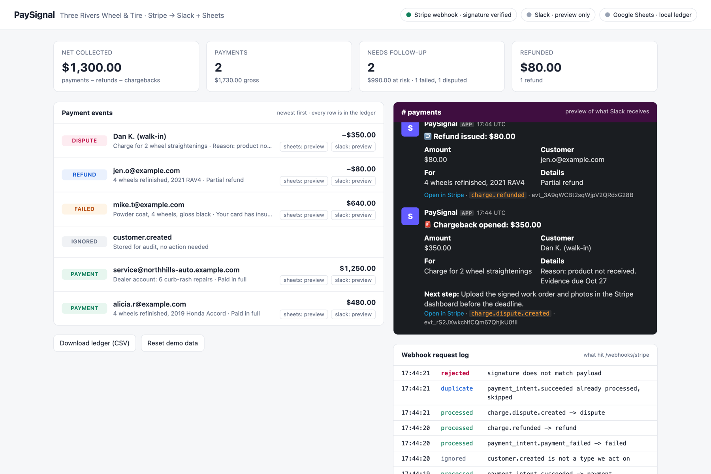
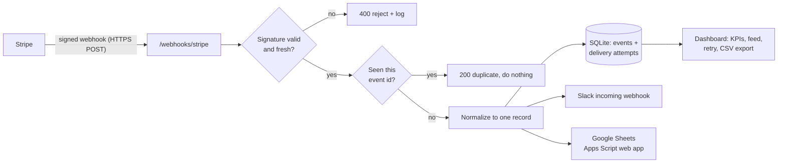

# PaySignal: Stripe payment events in Slack and Google Sheets

**A webhook integration that tells a small business, the moment it happens, when money comes in, fails to come in, or is being taken back. Every event also lands in a running ledger the bookkeeper can use.**



> Demo video: _coming soon_ · Run it yourself in 2 minutes, no Stripe account needed ([Quick start](#quick-start))

---

## The customer problem

*Three Rivers Wheel & Tire* (a fictional shop modeled on the wheel-repair businesses I sell to) takes card payments through Stripe: walk-in customers, plus monthly invoices to car dealerships.

In discovery, the owner described three problems:

| What happens today | What it costs |
|---|---|
| A customer's card fails, nobody notices, and the finished wheels go out the door unpaid | $400–$1,200 per missed payment, plus an awkward collections call |
| A chargeback email sits unread in the owner's inbox until the 7-day evidence deadline has passed | The shop loses the dispute by default, plus a $15 fee |
| The bookkeeper re-types every Stripe payout into a spreadsheet at month end | About 3 hours a month, with errors |

The shop already lives in Slack (the front desk and the techs use it all day) and in Google Sheets (for the books). **What they want: no new tool to log into.** The money events should show up where the team already works.

## The solution

PaySignal listens to Stripe webhooks and does three things for each event:

1. **Posts a Slack message to `#payments`** with the amount, the customer and the job. For failures and chargebacks it adds a concrete **next step**.
2. **Appends a row to a Google Sheet**, so the ledger builds itself as payments happen.
3. **Records the event and each delivery attempt** on a small dashboard, so if Slack or Sheets is down, nothing is lost and anyone can press *retry*.

| Stripe event | What the shop sees |
|---|---|
| `payment_intent.succeeded` | ✅ **Payment received: $480.00** from the customer, for the job |
| `payment_intent.payment_failed` | ⚠️ **Payment failed: $640.00**, with the decline reason. *Next step: get another card before releasing the job.* |
| `charge.refunded` | ↩️ **Refund issued: $80.00**, full or partial |
| `charge.dispute.created` | 🚨 **Chargeback opened: $350.00**, with the reason and the evidence due date. *Next step: upload the signed work order.* |
| anything else | Acknowledged and stored for audit. No noise in Slack. |

## How it works



**Stack:** Python, Flask, SQLite, Slack Block Kit, Google Apps Script. No Stripe SDK: the signature check is about 30 lines (`paysignal/stripe_signature.py`) so it's easy to read and audit.

## Design decisions (the questions a customer's engineer will ask)

**"How do you know the request is really from Stripe?"**
Every request's `Stripe-Signature` header is checked: HMAC-SHA256 over the exact raw body with the endpoint's signing secret, compared in constant time. Requests older than 5 minutes are rejected too, which blocks replays. A request where the amount was changed after signing gets a `400` and is logged. You can see this in the demo.

**"Stripe retries webhooks. Will we get double alerts?"**
No. Stripe delivers *at least once*, so the same event can arrive twice. The event id (`evt_...`) is the primary key in the database, so a repeat is acknowledged with `200` and nothing is posted again. The Google Sheets script also skips a row it already has.

**"What if Slack is down?"**
The event is saved *before* we deliver it. If Slack or Sheets fails, the attempt is recorded as `failed` with the error, Stripe still gets a `200` (otherwise Stripe would keep re-sending an event we already have), and the dashboard shows a **retry** button. In production I'd move delivery to a background queue with automatic backoff. The data model is already set up for that.

**"Why Apps Script instead of the Sheets API?"**
For a 5-person shop, setting up a Google Cloud service account and managing its JSON key is a lot of ongoing work. An Apps Script web app is 30 lines that the owner can read, deploy in 3 minutes and revoke with one click. For a larger customer I'd switch to the Sheets API with a service account.

**"What data are you storing?"**
The raw event (for audit and replay) and the fields shown in Slack. No card numbers ever reach this app; Stripe never sends them in webhooks.

## Quick start

### Option A: demo mode (2 minutes, no accounts)

```bash
git clone https://github.com/tairovpro/paysignal && cd paysignal
python3 -m venv .venv && source .venv/bin/activate
pip install -r requirements.txt
cp .env.example .env
python run.py                     # dashboard at http://127.0.0.1:5050
```

In a second terminal:

```bash
source .venv/bin/activate
python simulate.py story          # a day at the shop, one event every 2 seconds
```

`simulate.py` sends real Stripe event shapes, signed exactly as Stripe signs them. The story is: two payments, an event we ignore, a declined card, a partial refund, a chargeback, a Stripe retry of the first event (deduplicated) and a forged request (rejected).

### Option B: real Stripe test mode + Slack

1. **Slack:** create an app at api.slack.com/apps → *Incoming Webhooks* → add to `#payments` → paste the URL into `SLACK_WEBHOOK_URL`.
2. **Google Sheets (optional):** follow the 3 steps at the top of [`integrations/google_sheets.gs`](integrations/google_sheets.gs) and paste the URL into `SHEETS_WEBHOOK_URL`.
3. **Stripe:** install the Stripe CLI (`brew install stripe/stripe-cli/stripe`), then:
   ```bash
   stripe login
   stripe listen --forward-to 127.0.0.1:5050/webhooks/stripe   # prints a whsec_... secret
   ```
   Put that `whsec_...` value in `STRIPE_WEBHOOK_SECRET`, restart `python run.py`, then:
   ```bash
   stripe trigger payment_intent.succeeded
   stripe trigger payment_intent.payment_failed
   stripe trigger charge.refunded
   stripe trigger charge.dispute.created
   ```

To deploy for real, host `run.py` behind HTTPS (Render, Fly.io, Railway) and add the URL as an endpoint under Stripe Dashboard → Developers → Webhooks.

## Tests

```bash
pytest -q
```

19 tests cover the signature check (wrong secret, malformed header, stale timestamp, tampered body), currency handling (cents and zero-decimal currencies), duplicate suppression, ignored events, and the failed-delivery → retry path.

## What I'd build next

- **Daily digest** at 6pm in Slack: collected today, still unpaid, disputes with deadlines this week
- **Background queue with backoff** for deliveries (RQ or Celery), replacing the manual retry button
- **Routing rules:** chargebacks also go to the owner's phone by SMS; dealer payments go to `#dealer-accounts`
- **QuickBooks Online** as a destination, for shops that have outgrown a spreadsheet

---

Built by [Mukhammed Mamatysaev](https://www.linkedin.com/in/mukhammed-mamatysaev-1a5b79287/). I sell a technical service to auto shops and build software tools for small businesses.
